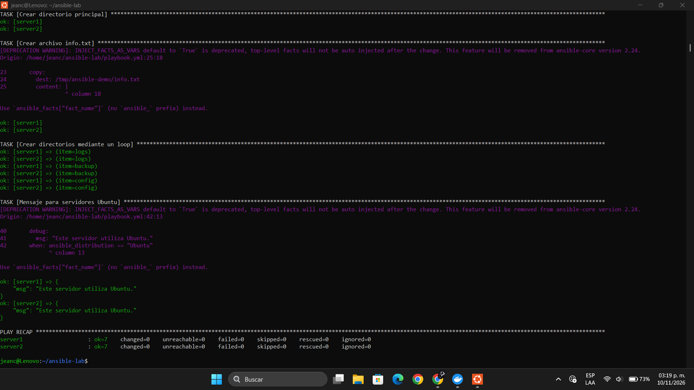

# Laboratorio Ansible con Docker

## Objetivo de la práctica

Crear un laboratorio con dos servidores Linux utilizando Docker y administrarlos mediante Ansible.

El objetivo es aprender a automatizar tareas en servidores, consultar información del sistema operativo, crear archivos y directorios y utilizar ciclos y condiciones.

## Requisitos

- Docker Desktop.
- Ubuntu mediante WSL.
- Ansible.
- Python 3.
- Colección community.docker.

## Iniciar los servidores

Ejecutar:

```bash
docker compose up -d
```

Comprobar los contenedores:

```bash
docker ps
```

## Instalar Python

```bash
docker exec server1 bash -c "apt update && apt install -y python3"
docker exec server2 bash -c "apt update && apt install -y python3"
```

## Comprobar conexión

```bash
ansible docker -i inventory.ini -m ping
```

## Ejecutar el Playbook

```bash
ansible-playbook -i inventory.ini playbook.yml
```

## Tareas realizadas

- Mostrar el nombre de cada servidor.
- Mostrar el sistema operativo.
- Crear el directorio ansible-demo.
- Crear el archivo info.txt.
- Crear los directorios logs, backup y config mediante un loop.
- Mostrar un mensaje cuando el sistema operativo sea Ubuntu.

## Captura de pantalla


